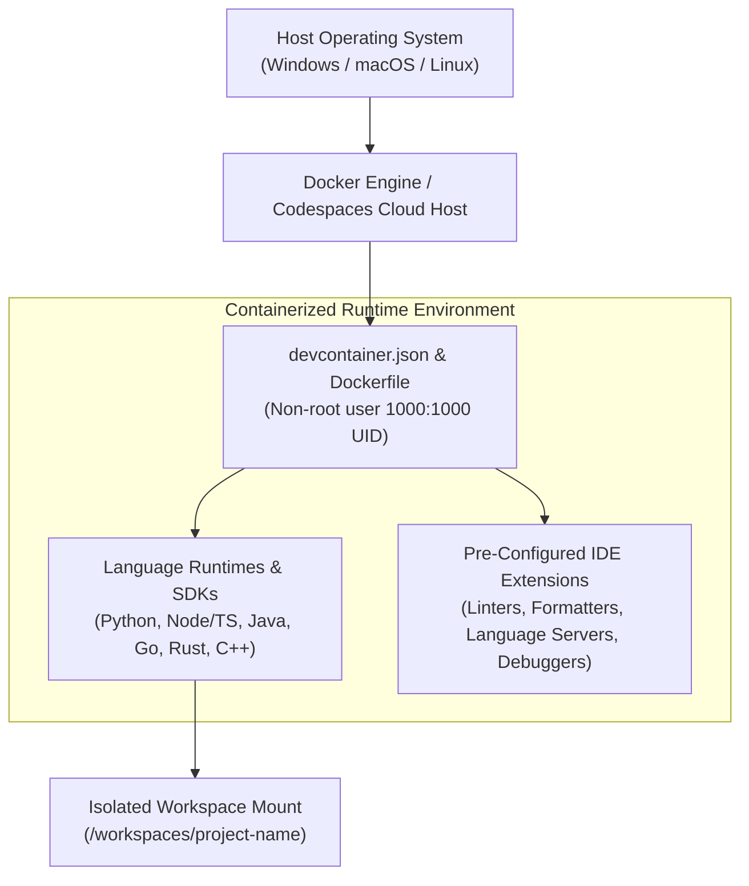

# devstarter — Standardized Zero-Config Devcontainer Templates

> **Source Repository:** [github.com/Pradeep-B28/Devstarter](https://github.com/Pradeep-B28/Devstarter)  
> **Author:** [B Pradeep](https://github.com/Pradeep-B28) · [Portfolio](https://pradeep-b28.github.io/Pradeep-B28/)

---

## Overview

**devstarter** provides reproducible, production-ready development container templates for VS Code Remote Containers and GitHub Codespaces. It standardizes language runtimes, linters, debuggers, formatters, and IDE extensions across distributed engineering teams, eliminating configuration drift and "works on my machine" bottlenecks.



---

## Supported Language Stacks

| Language / Stack | Directory | Pre-Installed Tooling & Linters | Base Container Image |
| :--- | :--- | :--- | :--- |
| **Python 3.11+** | [`template/python`](template/python) | Pyright, Ruff, Black, pytest, Jupyter, ipykernel, git | `mcr.microsoft.com/devcontainers/python:3.11` |
| **Node.js / TypeScript** | [`template/node`](template/node) | ESLint, Prettier, Vitest, npm, pnpm, yarn | `mcr.microsoft.com/devcontainers/typescript-node:20` |
| **Java 17+** | [`template/java`](template/java) | Java Extension Pack, Maven, Gradle, Spring Boot tools, JUnit | `mcr.microsoft.com/devcontainers/java:17` |
| **Go 1.21+** | [`template/go`](template/go) | Official Go Extension, gopls, golangci-lint, delve debugger | `mcr.microsoft.com/devcontainers/go:1.21` |
| **Rust** | [`template/rust`](template/rust) | rust-analyzer, cargo-edit, CodeLLDB debugger, clippy, rustfmt | `mcr.microsoft.com/devcontainers/rust:latest` |
| **C / C++** | [`template/cpp`](template/cpp) | GCC, Clang, CMake, GDB, LLDB, C/C++ Extension Pack | `mcr.microsoft.com/devcontainers/cpp:debian` |

---

## Quick Start Guide

### 1. Local Setup with VS Code & Docker
1. Ensure **Docker Desktop** is running on your machine.
2. Install the **Dev Containers** extension in VS Code.
3. Copy the appropriate language directory from `template/<language>` into your project's `.devcontainer/` folder:
   ```bash
   # Example: adopting the Java 17 template
   mkdir -p my-project/.devcontainer
   cp -r devstarter/template/java/* my-project/.devcontainer/
   ```
4. Open `my-project` in VS Code and select **"Reopen in Container"** when prompted.

### 2. GitHub Codespaces Setup
1. Commit the `.devcontainer/` directory to your GitHub repository.
2. In your repo on GitHub, click **Code** -> **Codespaces** -> **Create codespace on main**.
3. The cloud environment will initialize with all runtimes, language servers, and dependencies pre-installed.

---

## Devcontainer CLI Usage

You can also orchestrate containers directly via the official `@devcontainers/cli`:

```bash
# Install Dev Containers CLI globally
npm install -g @devcontainers/cli

# Build and start container for the current directory
devcontainer up --workspace-folder .

# Execute interactive shell command inside the running container
devcontainer exec --workspace-folder . bash
```

---

## License

This project is licensed under the [MIT License](LICENSE).
